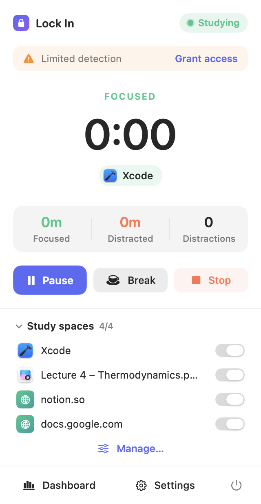

<div align="center">
  
  <h1>Lock In</h1>
  <p><strong>A gentle nudge back to what matters.</strong></p>
  <p>Choose your study spaces. Start a session. Get a reminder when you drift away.</p>
  <p>
    <a href="https://github.com/saiompatro/lock_in/actions/workflows/ci.yml"></a>
    <a href="LICENSE"></a>
    
    
  </p>
  <p><a href="#download">Download</a> · <a href="#installation">Install</a> · <a href="#build-from-source">Build</a> · <a href="CONTRIBUTING.md">Contribute</a></p>
</div>

Lock In is a free, open-source focus companion for macOS and Windows. Allow the apps and windows you want to work in; when you leave them, a distraction timer starts. Return before the threshold and it resets. Stay away and Lock In reminds you to come back or take a break.

No accounts, subscriptions, analytics, or app network requests. Your data stays on your computer.

<p align="center"></p>
<p align="center"><em>The macOS menu bar app, shown with sample data. Windows has a separate native tray interface.</em></p>

## Download

**First public beta: v1.0.0-beta.1.** Download the ZIP for your computer:

| Platform | Download | Requirements |
| --- | --- | --- |
| macOS — Apple Silicon & Intel | [Lock-In-macOS-universal.zip](https://github.com/saiompatro/lock_in/releases/download/v1.0.0-beta.1/Lock-In-macOS-universal.zip) | macOS 14 Sonoma or later |
| Windows — Intel / AMD (x64) | [Lock-In-Windows-x64.zip](https://github.com/saiompatro/lock_in/releases/download/v1.0.0-beta.1/Lock-In-Windows-x64.zip) | Windows 10/11, 64-bit |
| Windows — ARM64 | [Lock-In-Windows-arm64.zip](https://github.com/saiompatro/lock_in/releases/download/v1.0.0-beta.1/Lock-In-Windows-arm64.zip) | Windows on ARM |

[All releases and release notes](https://github.com/saiompatro/lock_in/releases) · [SHA-256 checksums](https://github.com/saiompatro/lock_in/releases/download/v1.0.0-beta.1/SHA256SUMS.txt)

The Windows port is new and has fewer features than macOS; see the comparison below. The Windows ARM64 build is cross-compiled and needs real-device testing. These community builds are **not notarized on macOS** and **not Authenticode-signed on Windows**, so installation may show OS security prompts.

## Installation

### macOS

1. Download and unzip `Lock-In-macOS-universal.zip`.
2. Drag **Lock In.app** into **Applications**, then open it.
3. If Gatekeeper blocks the unnotarized app, first verify you downloaded this repository's release. After attempting to open it, go to **System Settings → Privacy & Security → Open Anyway** and confirm. If your organization disallows this, build from source instead; do not disable Gatekeeper globally.
4. A lock icon appears in the menu bar. Follow the welcome screen and grant the permissions below.

| Permission | Used for | If denied |
| --- | --- | --- |
| Accessibility | Focused window title and minimized/hidden state | App-level matching; window rules fall back to the whole app |
| Automation (per browser) | Active tab URL in supported browsers | Website rules require a title keyword fallback |
| Notifications | Notification-style reminders | The on-screen pop-up is used instead |

Accessibility is in **System Settings → Privacy & Security → Accessibility**. After replacing or rebuilding the ad-hoc signed app, you may need to remove and re-add it there.

### Windows

1. Download the **x64** ZIP for most PCs, or **ARM64** for Windows on ARM. Check **Settings → System → About → System type** if unsure.
2. Right-click the ZIP → **Extract All** into a permanent folder, such as `Documents\Lock In`.
3. Open **LockIn.exe**. No administrator access or separate .NET installation is needed.
4. An unsigned-app reputation warning may appear. Check the release source and checksum before proceeding. Managed PCs may require administrator approval.
5. Add study spaces and start a session. Closing the window keeps the app in the system tray; double-click its tray icon to reopen, or right-click → **Quit** to exit.

To update, quit Lock In and replace the extracted app files. Your data is stored separately. To uninstall, quit and delete the application folder; optionally remove the local data folder listed under Privacy.

### Verify a download

Compare the result with the matching entry in `SHA256SUMS.txt` from the same release:

```bash
# macOS
shasum -a 256 ~/Downloads/Lock-In-macOS-universal.zip
```

```powershell
# Windows PowerShell
Get-FileHash "$HOME\Downloads\Lock-In-Windows-x64.zip" -Algorithm SHA256
```

## Make it your study space

1. **Add spaces.** Allow a whole app (Notes, your editor), or a specific window using a title keyword (for example, `Lecture 4`). On macOS you can also allow a website domain or URL path. On Windows, choose the browser process and enter a distinctive tab-title keyword, such as `Notion`.
2. **Start a session.** Moving between allowed spaces keeps you studying. Leaving them starts the distraction timer; returning resets it.
3. **Set your reminder.** The default threshold is five minutes. Choose repeat reminders and sound in Settings.
4. **Take a break.** Pause manually, take a timed break, or end the session. Locking your computer or putting it to sleep pauses tracking automatically.
5. **See your progress.** Both versions store session history. macOS also includes focus goals, streaks, charts, and distraction insights.

Lock In's own windows are neutral: opening its panel keeps the previous tracking state. It reminds you; it does not block other apps or websites.

## Platform support

| Feature | macOS | Windows beta |
| --- | --- | --- |
| Native background interface | SwiftUI menu bar app | Windows Forms system tray app |
| Whole-app / window-title study spaces | Yes | Yes, by process name / title keyword |
| Website URL matching | Supported browsers | Title keywords only; URLs are not read |
| Custom threshold / repeat reminders / sound | Yes | Yes |
| On-screen reminder | Full-screen pop-up and/or notification | Reminder window and tray balloon |
| Pause / timed break / lock and sleep pause | Yes | Yes (5-minute timed break) |
| Local session history / interrupted-session recovery | Yes | Yes |
| Daily goals, streaks, charts, distraction breakdown | Yes | Today's total and basic session history |
| Launch at login | Built-in setting | Not built in |

### macOS browser support

Safari, Safari Technology Preview, Orion, Chrome (including Beta/Canary), Arc, Brave, Edge, Vivaldi, Opera, and Chromium support active-tab URL detection. Firefox and Zen use **title keyword** matching because they do not expose the required AppleScript interface.

A domain such as `notion.so` matches the site and its subdomains. A URL path such as `docs.google.com/document/d/abc` narrows the match to that path prefix. The browser must be frontmost and its window visible. URL checks run only for the frontmost browser during a session.

Windows title keywords are less precise: different pages can have the same title, and titles can change. Avoid allowing an entire browser if you want to distinguish study tabs from distracting ones.

## Privacy

- The foreground app and focused window title are checked during a session. macOS also reads the active tab URL when needed. The explicit app/window pickers enumerate open apps/windows/tabs so you can choose a space.
- **Stored:** the study-space rules you enter (including any title keyword or URL pattern), preferences, and session totals. macOS also records distraction app names, event timing, and focus per space. Windows stores aggregate session totals and reminder counts.
- **Not stored:** automatically observed window titles, active URLs, page content, keystrokes, or browser history. The app has no telemetry or network service.
- macOS files: `~/Library/Application Support/Lock In/`; preferences use macOS UserDefaults.
- Windows files: `%LOCALAPPDATA%\Lock In\` (`study-spaces.json`, `settings.json`, `sessions.json`, and an active-session snapshot).
- Delete saved session history in Settings. To remove all data, quit and delete the data folder; macOS preferences can also be removed with `defaults delete com.lockin.LockIn`.
- Active sessions are saved every 30 seconds for recovery after an unexpected exit. Data files are local, unencrypted JSON protected by your operating-system account.

## Build from source

```bash
git clone https://github.com/saiompatro/lock_in.git
cd lock_in
```

### macOS development

Requires **macOS 14+**, **Xcode 16+** (the tests use Swift Testing), and [XcodeGen](https://github.com/yonaskolb/XcodeGen).

```bash
brew install xcodegen
make build       # Release app in build/Build/Products/Release/Lock In.app
make test        # Matcher and session engine tests
make install     # Build, install to /Applications, and open
```

For Xcode development, run `make project`, open `LockIn.xcodeproj`, select **LockIn**, and press **⌘R**. The app is not sandboxed because it uses Accessibility and Apple Events. Local builds are ad-hoc signed.

### Windows development

Install the [.NET 10 SDK](https://dotnet.microsoft.com/download/dotnet/10.0) on Windows. Visual Studio is optional.

```powershell
dotnet run --project Windows/LockIn.Windows
dotnet run --project Windows/LockIn.Core.Tests -c Release

# Self-contained portable executable; use win-arm64 for ARM devices
dotnet publish Windows/LockIn.Windows -c Release -r win-x64 --self-contained true -p:PublishSingleFile=true -p:IncludeNativeLibrariesForSelfExtract=true -p:DebugType=None -o dist/windows
```

Run `dist\windows\LockIn.exe`. Core tests also run on macOS/Linux with .NET 10; building the UI elsewhere requires the Windows targeting packs, and running it requires Windows.

### Repository layout

```text
LockIn/                   Native macOS app (SwiftUI + AppKit)
LockInTests/              Swift matching and session engine tests
Windows/LockIn.Core/      Platform-independent Windows matching/timing models
Windows/LockIn.Core.Tests/ Executable regression tests (no test packages required)
Windows/LockIn.Windows/   Native Windows UI, monitoring, tray, and JSON storage
.github/workflows/        macOS/Windows CI and tagged release packaging
project.yml               XcodeGen source of truth
Scripts/                  macOS icon generation
```

See [ARCHITECTURE.md](ARCHITECTURE.md) for the macOS design and [release instructions](docs/RELEASING.md) for packaging and signing details.

## Contribute and get help

Found a bug or have an idea? [Open an issue](https://github.com/saiompatro/lock_in/issues/new/choose). Windows testing, accessibility feedback, and feature contributions are welcome. Please read [CONTRIBUTING.md](CONTRIBUTING.md), and use [SECURITY.md](SECURITY.md) for vulnerability reports.

## License

[MIT](LICENSE) © 2026 Saiom Patro. Free to use, modify, and share.
